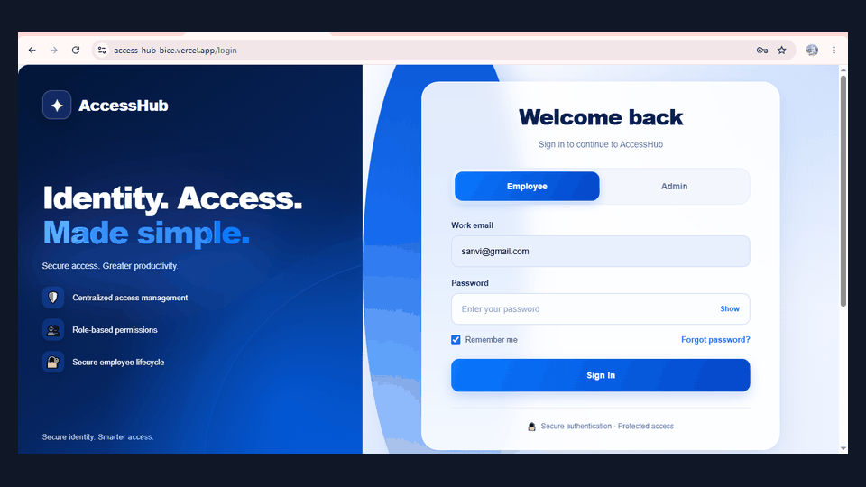

# 🚀 Employee Management System (AccessHub)

### Manage Employees. Control Access. Stay Organized.

> A full-stack web application that helps organizations manage employees, roles, applications, and access permissions from one place. It also supports employee onboarding, offboarding, and activity tracking.

<p>
  
  - 🌐 [Live Demo](https://access-hub-bice.vercel.app/) &nbsp;  &nbsp;
  - 💻 [GitHub Repository](https://github.com/Jhanwi/AccessHub)
</p>

## ✨ Key Features

- 📊 **Dashboard:** View employee statistics and recent activities.
- 👥 **Employees:** Add and manage employee accounts.
- 🛡️ **Roles:** Create roles and manage permissions.
- 🖥️ **Applications:** Manage connected applications.
- 🔑 **Access Management:** Grant and revoke application access.
- 👋 **Onboarding & Offboarding:** Manage employee joining and exit processes.
- 📋 **Audit Logs:** Track important activities and changes.

## 📸 Project Preview

Explore the different features of Employee Management System through this slideshow.

<p align="center">
  
</p>

*The slideshow automatically cycles through all 11 application screens.*

## 🛠️ Tech Stack

| Category | Technologies |
|---|---|
| Frontend | React.js, Vite, CSS |
| Backend | Node.js, Express.js |
| Database | PostgreSQL |
| Authentication | JWT, RBAC |
| Tools | Docker, Git, GitHub, Postman |

## ⚡ Run Locally

**1. Clone the repository**

```bash
git clone https://github.com/Jhanwi/AccessHub.git
cd AccessHub
```

**2. Configure the required environment variables.**

**3. Start with Docker**

```bash
docker compose up --build
```

**4. Open:** `http://localhost:5174`

*Make sure Docker and the required environment variables are configured.*

## 💡 What I Learned

- Full-stack application development.
- JWT authentication and protected routes.
- Role-Based Access Control (RBAC).
- REST API development.
- PostgreSQL database management.
- Docker-based application setup.

---

### 👩‍💻 About

I developed this project to gain practical experience in full-stack development and understand how employee management and access control work in real-world organizations.

⭐ Feel free to explore the project and share your feedback!


  ### **AccessHub — One Platform. Smarter Employee Management.**

